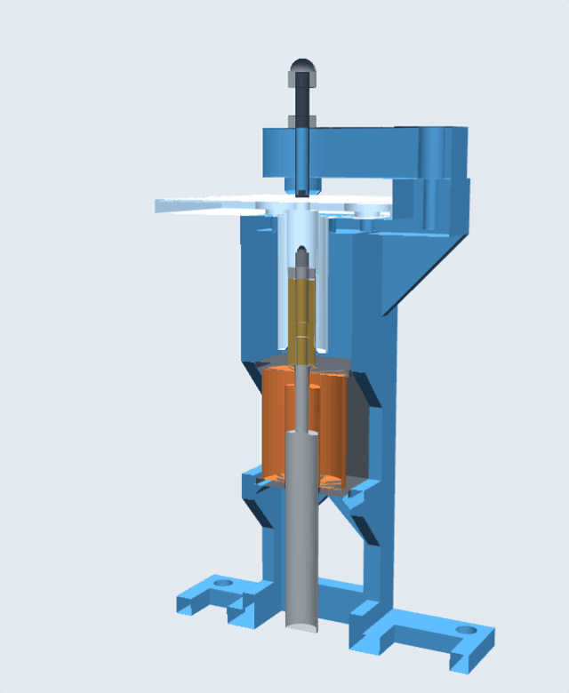
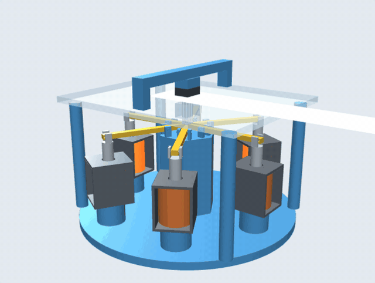

# Punch Point

- **Punch test rig viewer:** <https://b-47.github.io/punch-point/test-rig/viewer/>

  

- **Six-solenoid head viewer:** <https://b-47.github.io/punch-point/concepts/six_solenoid_head/viewer/>

  

## License

MIT, see [LICENSE](LICENSE).
