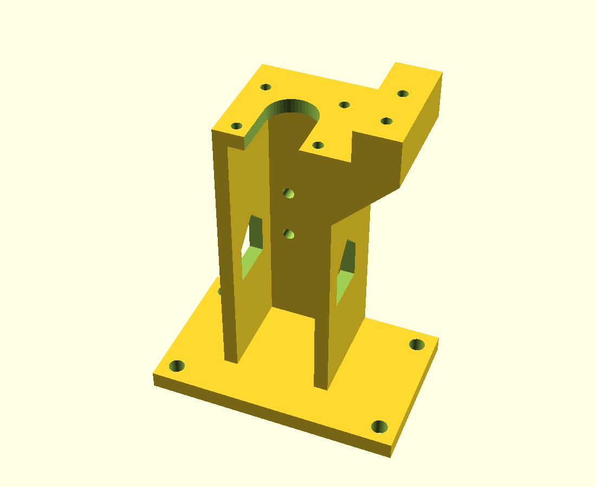

# Punch Point

Punch Point is a student team in UIUC's MedLaunch program. We're building a low-cost, portable braille embosser that a Teacher of the Visually Impaired can use to emboss `.brf` files on 8.5 × 11 cardstock.

We're still at the bench-test stage: one solenoid punching one dot, to work out pulse length, die height and paper weight before we build a six-actuator head.

## What's here

| Folder | Contents |
| --- | --- |
| [`test-rig-v3/`](test-rig-v3/) | Single-dot punch test rig: OpenSCAD model, printable STLs, a PrusaSlicer project, ESP32 test firmware and an offline 3D viewer. Start with its [README](test-rig-v3/README.md). |
| [`concepts/`](concepts/) | Early design sketches, not tested or print-ready. `six_solenoid_head/` is a lever-driven six-pin head that punches a whole braille cell per strike. |

### Quick look

- **3D viewer:** open `test-rig-v3/viewer/index.html` in a browser. It animates a strike and lets you change paper thickness, die height, die socket and stylus tip.
- **Printable parts:** `test-rig-v3/print/*.stl`
- **Source CAD:** `test-rig-v3/cad/punch_rig_v3_003.scad` (OpenSCAD)

## License

MIT, see [LICENSE](LICENSE). The viewer bundles three.js r128, which is also MIT.
