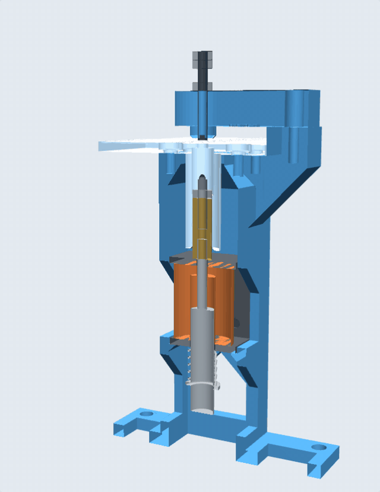

# Braille punch test rig

This rig embosses one braille dot at a time.

- [Build guide](build-guide.md)
- [Design notes](design-notes.md)
- [Test plan](test-plan.md)
- [3D viewer](https://b-47.github.io/punch-point/concepts/test-rig/viewer/)

## Files

| File | What it is |
| --- | --- |
| `cad/punch_rig_009.scad` | The 3D model, in OpenSCAD. Older versions are in `cad/iterations/`. |
| `print/rig_plate.3mf` | All the printed parts on one plate for a Prusa Core One: about 68 g of PLA and 3 hours 50 minutes. |
| `print/*.stl` | Each printed part. |
| `print/*.scad` | One file per printed part, to export its STL. |
| `firmware/punch_test/` | Code for the ESP32 that fires the solenoid. |
| `media/circuit.svg` | The circuit diagram. `circuit.png` is the same diagram for slides. |
| `test-log.csv` | A blank sheet for test results. |
| `viewer/` | The 3D viewer. |
