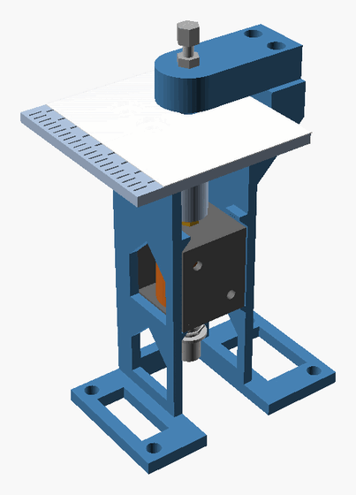
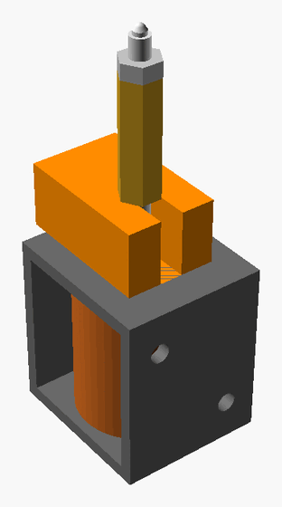
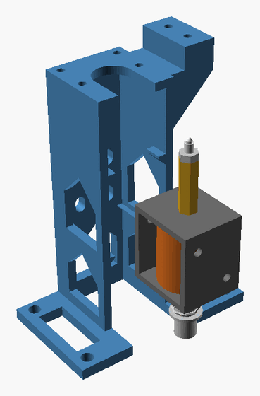
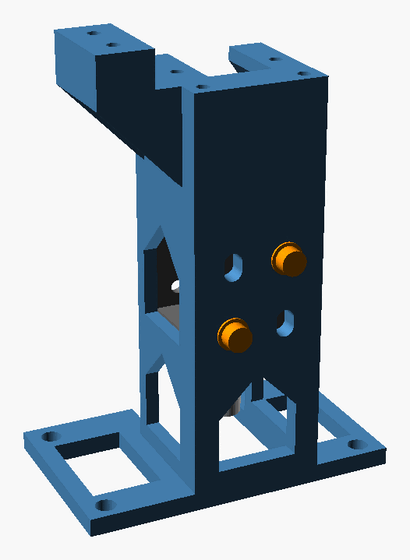
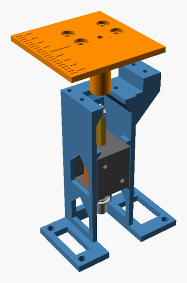
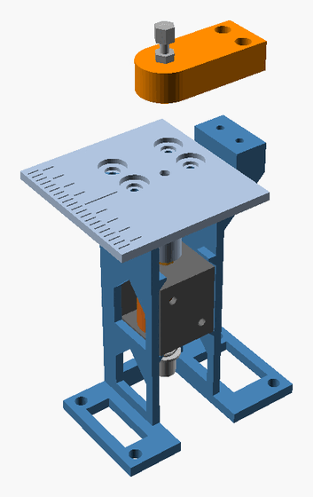
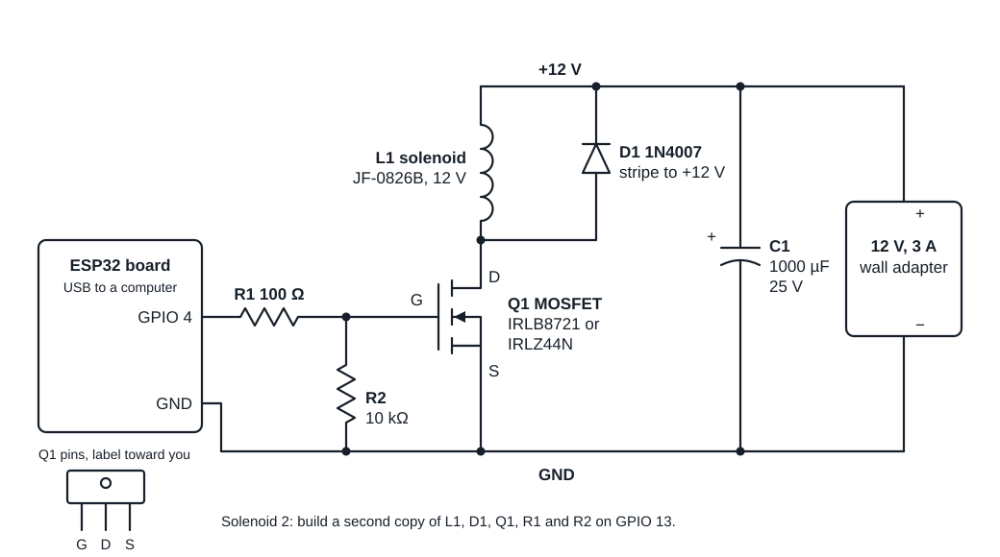

# Build the punch test rig

This guide takes you from the print files to the first embossed dot. You will:
1. Print the parts. This takes about 2 hours 40 minutes of printer time.
2. Buy the hardware on the list below.
3. Put the rig together. This takes about an hour.
4. Wire the electronics and load the code.
5. Fire the first dot.

The [design notes](design-notes.md) explain why the rig looks the way it does. After the build, run the [test plan](test-plan.md).

## What you need

### Printed parts

Print these in PLA, a common 3D printing plastic. We use PLA for the first test print because it bridges cleanly and strings less. The files are in [`print/`](print/).

| File | What it holds | Plastic and time |
| --- | --- | --- |
| `rig_plate.3mf` | The frame, two tables, the die arm, three fence shims and the stroke spacer | 56 g, about 2 hours 40 minutes |

The file holds settings for a Prusa Core One with a 0.4 mm high-flow nozzle:
- Prusament PLA
- 0.2 mm layers
- 3 perimeters
- 4 top and 4 bottom layers
- 15% gyroid infill
- a 5 mm brim
- no supports

For another printer, use the STL files in the same folder with the same settings. STL is the usual 3D printing format.

The plate has two tables. They differ only in how tightly the stylus guide fits. A number underneath tells them apart: 5.8 is the tighter one, and 6.0 is the looser one.

### Hardware

Solenoid and stylus:
- 1 JF-0826B solenoid, 12 V. A solenoid is an electromagnet with a steel rod inside, the plunger. The plunger jumps 10 mm when you switch the power on.
- 1 M3 x 18 hex standoff: threaded inside all the way through, 5.5 mm across its flat sides, in steel. A standoff is a hex spacer, like a long nut.
- 2 or 3 M3 x 16 dog-point set screws. A set screw has no head, and a dog-point set screw has a narrow tip. You file one tip round to make the stylus, the steel pin that presses the dot. Get spares in case the filing goes wrong.
- 1 M3 nut, to lock the stylus.

Die (the metal socket that shapes the dot):
- 1 M3 x 25 set screw. An M3 x 30 also works.
- 3 M3 nuts.

Frame:
- 2 M3 x 6 socket head screws and 2 M3 washers. They go through the back wall into the solenoid's own threaded holes.
- 4 M3 x 6 button head screws, for the table.
- 2 M3 x 16 socket head screws and 2 M3 washers, for the arm.

Electronics:
- 1 ESP32 board and a USB cable that carries data. The ESP32 is a small board you can program.
- 1 logic-level MOSFET, an electronic switch: IRLB8721 or IRLZ44N.
- 1 1N4007 diode.
- 1 100 ohm resistor and 1 10k ohm resistor.
- 1 1000 µF (microfarad) capacitor, rated for 25 V or more.
- 1 sealed 12 V wall adapter, rated 3 A or more, with a 5.5 x 2.1 mm barrel plug. Use a sealed adapter, not an open-frame power supply with bare terminals.
- 1 barrel jack to screw terminal adapter.
- A breadboard and jumper wires.

### Tools

- Calipers.
- Hex keys: 1.5 mm, 2 mm and 2.5 mm. A 2.5 mm key with a ball end helps.
- A 5.5 mm wrench and small pliers, to tighten two nuts against each other.
- An M3 tap with a tap wrench. A tap cuts a thread in a hole. If you don't have one, step 6 gives another way.
- A fine file or a sharpening stone.
- A drill, if you have one, to spin the stylus while you file it.
- A US dime, as a height gauge.

## 1. Print the parts

1. Print the rig plate.
2. Peel off the brim. Check that every screw hole is clear.

## 2. Make the stylus

1. File the narrow tip of one dog-point set screw into a smooth dome.
   - The easy way: hold the set screw in a drill, tip out. Run the drill slowly and hold a fine file at an angle against the edge of the tip.
   - The tip should end up round and about 2 mm wide, with no sharp edge. A sharp edge cuts the paper instead of pressing it.
2. Screw an M3 nut onto the set screw from the socket end. Stop while the nut is still fully on the thread, a few millimeters from the tip.
3. Screw the set screw into the top of the standoff, socket end first. Turn it with the 1.5 mm hex key from the bottom of the standoff.
4. Stop when the tip sticks out 7.0 mm above the top of the standoff. Measure with calipers.
5. Turn the nut down onto the standoff.
6. Hold the standoff with the wrench and tighten the nut. Stop when the nut's flat sides line up with the standoff's flat sides. The table slides over both, so they must line up.
7. Measure again. The tip should still stick out 7.0 mm, give or take 0.2 mm.

The 7.0 mm suits a solenoid frame 27 mm long, as in the seller's drawing. For another length, see the [design notes](design-notes.md#check-these-on-the-real-parts).

## 3. Fit the standoff and set the stroke

The acorn nut on the solenoid also stops the plunger at rest, so it sets how far the plunger moves. That distance is the stroke. The standoff replaces the acorn nut, so you set the stroke again with the stroke spacer.

1. Unscrew the acorn nut and any washer under it from the push rod, the thin threaded rod on top of the solenoid. You won't need them.
2. Screw the standoff onto the push rod by a few turns.
3. Stand the solenoid on the bench on its spring end. Press down on the solenoid, so the plunger slides all the way in and the push rod sticks up as far as it goes.
4. Keep pressing. Slide the stroke spacer onto the push rod, flat on the solenoid.
5. Turn the standoff down until it touches the spacer.
6. Let go and take out the spacer.
7. Push the plunger in and out. The standoff should move about 10 mm.

Nothing locks the standoff onto the push rod. Once the table is on, its hex guide stops the standoff from turning, so the setting holds.

## 4. Fit the solenoid in the frame

1. Find the side of the solenoid with two threaded holes. It is one of its two flat steel sides.
2. Slide the solenoid in from the front, push rod up, with that side toward the back wall. The stylus passes through the slot in the deck, the flat top of the frame.
3. Push the solenoid back until it touches the back wall. Its bottom plate rests on two ledges inside the side walls.
4. Look through the four slots in the back wall. Two of them line up with the solenoid's holes.
5. Put an M3 x 6 socket head screw with a washer through each of those two slots. Tighten them with the 2.5 mm hex key. Use 6 mm screws, because longer ones can poke past the steel toward the coil.
6. Lead the solenoid's two wires out through a window in a side wall.

If no slot lines up with a hole, you can still run the first tests. Two small lips above the solenoid stop it from jumping, and the table holds it in place once it is on. Measure where the holes really are, so we can move the slots to match.

## 5. Fit the table

1. Take the table marked 5.8 underneath.
2. Lower it onto the deck, so the tube under it slides down over the stylus, nut and standoff.
3. Put in the 4 M3 x 6 button head screws, loosely.
4. Reach through the window in the back wall, under the solenoid, and push the plunger up as far as it goes.
5. Check the stylus tip. It should stand about 1.3 mm above the table, about as high as a dime is thick.
6. Move the table until the plunger slides up and down freely.
7. Tighten the 4 screws.
8. Let go of the plunger. It should drop back by itself, and the tip should sink below the table surface.

If the standoff sticks in the tube, use the table marked 6.0 instead.

## 6. Fit the die arm

1. Cut an M3 thread through the hole in the round end of the arm, from the top, with the M3 tap. If you don't have a tap, drive an ordinary M3 screw through the hole to cut the thread, then take it out.
2. Screw the M3 x 25 set screw in from the top, socket end first. The hex socket in its end is the die.
3. Stop when the end of the set screw is level with the lowest point of the arm, just under the hole.
4. Screw an M3 nut onto the set screw, down to the arm. Leave it loose. Later it locks the die height.
5. Screw two more M3 nuts onto the top of the set screw.
6. Hold the lower one with pliers, and tighten the top one down hard against it with the wrench. Locked together, the two nuts turn the set screw:
   - Turn the top nut clockwise to lower the die.
   - Turn the nut just under it counterclockwise to raise the die.
   - Each turn moves the die 0.5 mm.
7. Put the arm on top of the tower, the block that rises beside the table. Fix it with the two M3 x 16 socket head screws and washers, but leave the screws loose.
8. Push the plunger up and hold it there.
9. Turn the top nut clockwise until the die rests on the stylus tip.
10. Slide the arm until the tip drops into the die's hex socket.
11. Tighten the two arm screws. Then let go of the plunger.
12. Turn the nut just under the top nut one turn counterclockwise, to raise the die 0.5 mm.

## 7. Wire the electronics

Unplug the 12 V adapter whenever you change a wire.

Make these connections on the breadboard:
1. Plug the 12 V adapter into the barrel jack adapter. Wire its + terminal to one breadboard rail, the +12 V rail. Wire its − terminal to the other rail, the ground rail.
2. Put the capacitor across the two rails. Its longer leg goes to +12 V. The side with the stripe goes to ground. A capacitor put in backwards can burst.
3. Put the MOSFET in the breadboard. With its label toward you and its legs down, the pins are gate, drain and source, from left to right.
4. Wire one solenoid wire to +12 V and the other to the MOSFET's drain. The solenoid's wires can go either way round.
5. Put the diode next to the solenoid: its striped end to +12 V, its other end to the MOSFET's drain. A diode put in backwards shorts the adapter the moment the solenoid fires.
6. Wire the MOSFET's source to ground.
7. Wire the 100 ohm resistor from the MOSFET's gate to the ESP32 pin labeled GPIO 4.
8. Wire the 10k ohm resistor from the MOSFET's gate to ground. It keeps the solenoid off while the ESP32 starts up.
9. Wire an ESP32 pin labeled GND, for ground, to the ground rail.

The ESP32 gets its power from the USB cable. Never connect 12 V to the ESP32.

For a second solenoid, build a second copy of the solenoid, diode, MOSFET and both resistors. Wire its 100 ohm resistor to the pin labeled GPIO 13.

## 8. Load the code

The code is in [`firmware/punch_test/`](firmware/punch_test/). It runs on most ESP32 boards and on ESP32-S3 boards.

1. In VS Code, install the pioarduino IDE extension. Install it or PlatformIO IDE, not both.
2. Open the folder `firmware/punch_test`.
3. In the status bar, pick `esp32dev` for most ESP32 boards, or `esp32-s3` for ESP32-S3 boards.
4. Plug in the board and click Upload. The first time, this downloads several gigabytes of tools.
5. Open the Serial Monitor.

To move to a newer ESP32 toolkit later, change the release number in the `platform` line of `platformio.ini`.

## 9. Fire the first dot

Keep your fingers away from the stylus and die while the 12 V adapter has power.

1. Plug in the 12 V adapter.
2. Lay a strip of 65 lb cardstock on the table, with its edge against the fence. The fence is the side of the tower that faces the table.
3. In the Serial Monitor, type `f 25` and press Enter. The solenoid should click once.
4. Look at the paper. If there is no dot, turn the top nut a quarter turn clockwise and fire again.
5. Stop when the dot is round and firm and the paper isn't torn.
6. Tighten the nut on top of the arm to hold the setting.

Commands:

| Command | What it does |
| --- | --- |
| `f 25` | Fires one 25 ms pulse. |
| `f 25 2` | Fires one 25 ms pulse on solenoid 2. |
| `r 20 25 500` | Fires 20 pulses of 25 ms, one every 500 ms. |
| `w 5 40 5` | Each press of the button labeled BOOT on the ESP32 fires the next pulse length: 5 ms, then 10, up to 40. |
| `s` | Stops a run. |

The code never fires a pulse longer than 100 ms. It also keeps each solenoid off for at least 3 times as long as it was on, so the coil can't overheat.

Now run the [test plan](test-plan.md).

## If something goes wrong

| What you see | What to do |
| --- | --- |
| Nothing happens when you fire. | Check that the adapter has power and the MOSFET pins are in the right order. Check the wire from the ESP32's ground to the ground rail. |
| The adapter cuts out when you fire. | Unplug it. The diode is probably in backwards. |
| The solenoid stays on. | Check the 10k ohm resistor from the gate to ground, and the MOSFET pins. |
| The plunger sticks partway up. | Loosen the table screws and move the table until the plunger slides freely. If that doesn't help, use the table marked 6.0. |
| The stylus doesn't reach the paper. | Check the stroke (step 3) and that the stylus sticks out 7.0 mm (step 2). |
| In step 3, the standoff stops before it touches the spacer. | The push rod has reached the stylus inside the standoff. Leave the standoff where it stopped. Later, raise the die to match the higher tip. |
| The paper drags under the die. | Raise the die. Loosen the nut on top of the arm, then turn the nut just under the top nut counterclockwise. |
| The paper tears. | Raise the die, or file the stylus tip rounder. |
| Dots are faint. | Lower the die a quarter turn at a time, or use a longer pulse. |
| Dots get fainter during a session. | Tighten the nut on top of the arm, the arm screws and the two screws in the back wall. Check the stroke with the spacer (step 3). |

## Change the model

The model is [`cad/punch_rig_007.scad`](cad/punch_rig_007.scad), in OpenSCAD. After you change it:
1. Open each file in `print/` with OpenSCAD and export its STL, or run `openscad -o print/frame.stl print/frame.scad` for each part.
2. Slice the plate again.
3. Run `python3 tools/build_rig_parts.py` from the top of the repository to update the 3D viewer.
