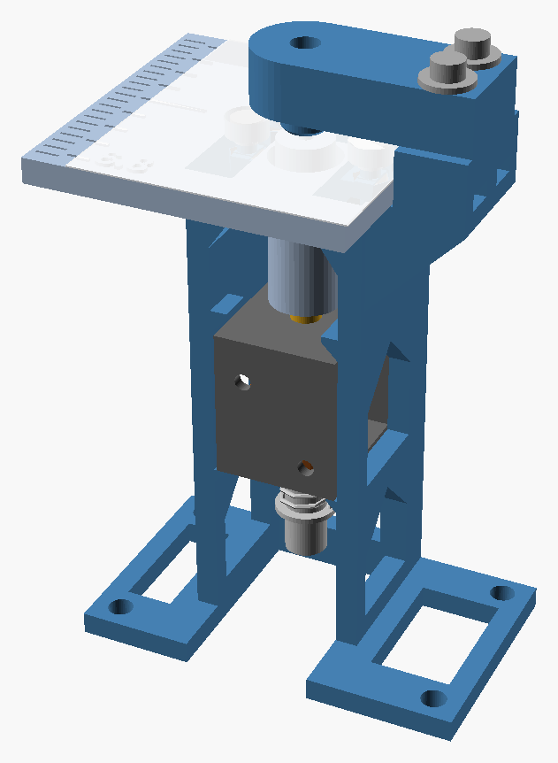
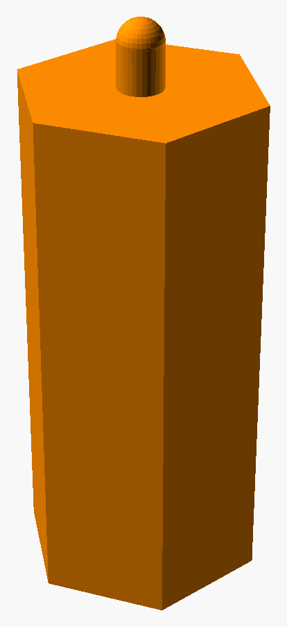
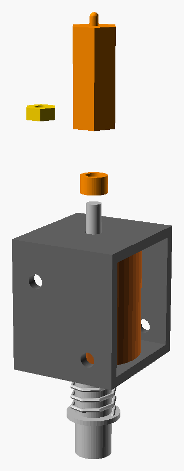
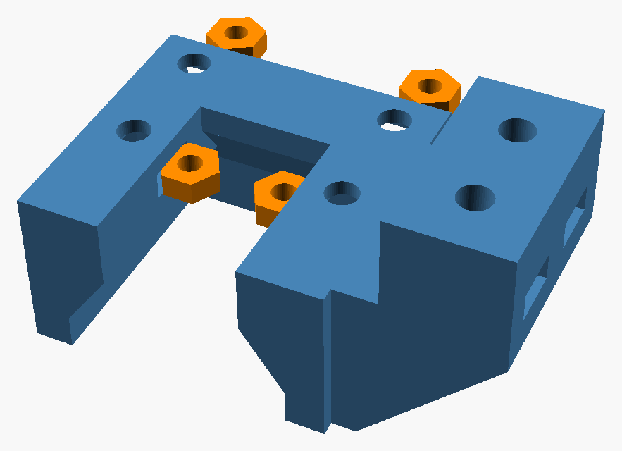
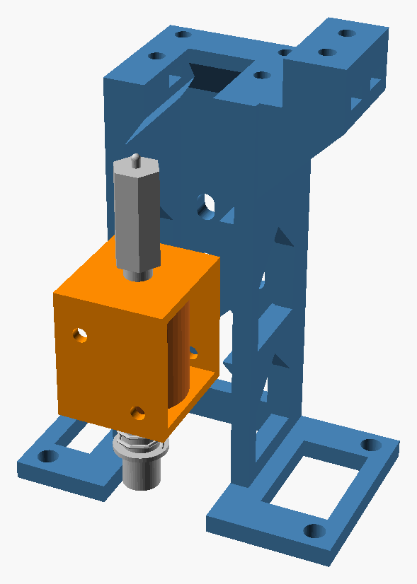
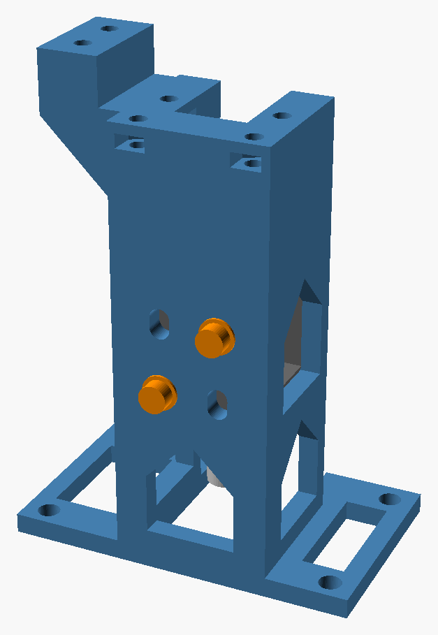
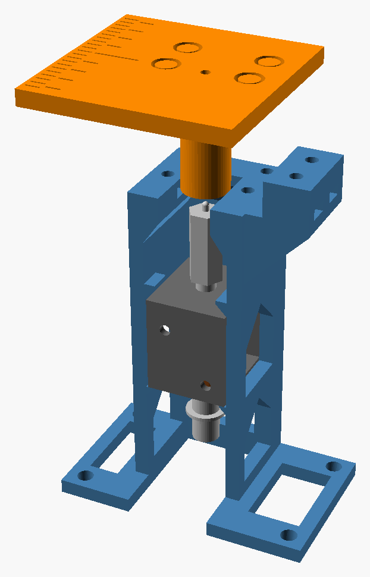
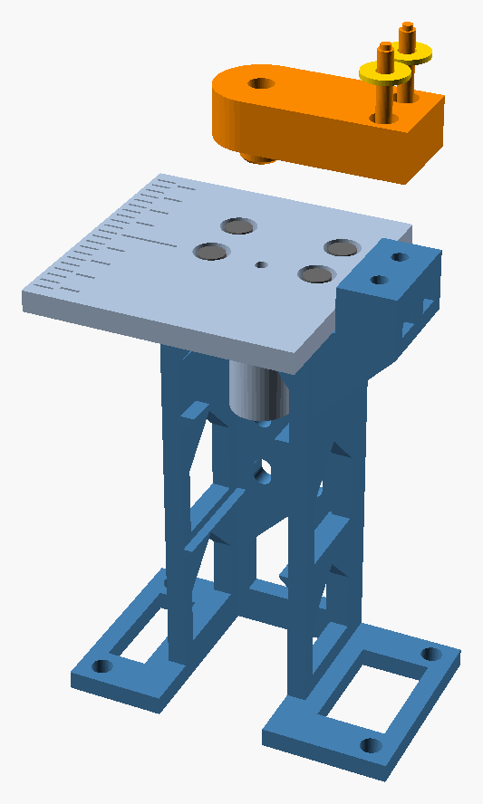
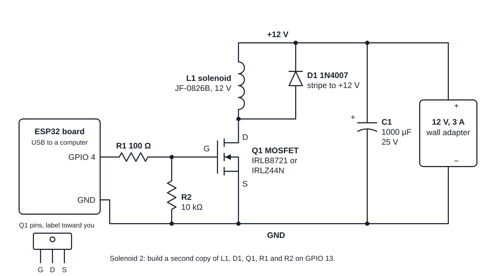

# Build the punch test rig

Printing takes about 2.5 hours, and assembly about an hour. After the build, run the [test plan](test-plan.md).

## What you need

### Printed parts

Print in PLA. The files are in [`print/`](print/).

| File | What it holds | Plastic and time |
| --- | --- | --- |
| `filament_plate_mk4.3mf` | The die arm, the coupler table (marked 8.3), one coupler and a 3.5 mm stop sleeve, for a Prusa MK4 | 11 g, 40 minutes |
| `filament_plate_coreone.3mf` | The same plate for a Prusa Core One | 11 g, 40 minutes |
| `frame.stl`, `shims.stl`, `washers.stl` | The frame, the fence shims and the arm washers. Print them if you don't have them from an earlier version. | |

The plate uses 0.20 mm layers, 2 perimeters, 4 top and 4 bottom layers, 15% gyroid infill, a 5 mm brim and no supports. For another printer, use the STL files with the same settings.

### Hardware

Solenoid, stylus and die:
- 1 JF-0826B solenoid, 12 V. A solenoid is an electromagnet with a steel rod inside, the plunger. The plunger jumps 10 mm when you switch the power on.
- The printed coupler. It screws onto the plunger's push rod by a captive nut. The pin on its top is the stylus, the part that pushes the paper.
- The hole in the arm's nose is the die. You need no screw or standoff for it.
- 1 M3 nut for the coupler.

Frame:
- 2 M3 x 6 socket head screws. They go through the back wall into the solenoid's own threaded holes.
- 4 M3 x 8 socket head screws and 4 M3 nuts, for the table. M3 x 10 also works.
- 2 M3 x 20 socket head screws and 2 M3 nuts, for the arm, with the 2 printed washers.

You need no M4 screws, no standoffs and no steel pins.

Electronics:
- 1 ESP32 board and a USB cable that carries data. The ESP32 is a small board you can program.
- 1 logic-level MOSFET, an electronic switch: IRLB8721 or IRLZ44N.
- 1 1N4007 diode.
- 1 100 ohm resistor and 1 10k ohm resistor.
- 1 1000 µF (microfarad) capacitor, rated for 25 V or more.
- 1 sealed 12 V wall adapter, rated 3 A or more, with a 5.5 x 2.1 mm barrel plug. Use a sealed adapter, not an open-frame power supply with bare terminals.
- 1 barrel jack to screw terminal adapter.
- A breadboard and jumper wires.

### Tools

- Calipers.
- A 2.5 mm hex key. One with a ball end helps.
- Small pliers or a 5.5 mm wrench, to hold nuts.
- Tweezers, to place two of the nuts.
- Fine sandpaper, 400 grit or finer, to smooth the stylus's tip. Optional, but the dots come out cleaner.

## 1. Print the parts

1. Print the rig plate.
2. Peel off the brim. Check that every screw hole is clear.

## 2. Check the stylus

1. Look at the pin on top of the coupler.
2. Run a fingernail over the tip. If you feel a bump or a thread of plastic, rub the tip on fine sandpaper until it is smooth and round. A rough or sharp tip cuts the paper instead of pressing it.

The stylus is 1.7 mm across. A braille dot is about 1.5 mm across, so no other pin is needed.

## 3. Fit the coupler to the solenoid

1. Unscrew the acorn nut and the black rubber washer from the push rod, the thin threaded rod on top of the solenoid. You won't need them. Hold the plunger while they're off, or it can slide out of the spring end.
2. Slide a 3.5 mm stop sleeve, the short printed tube, over the push rod and down onto the solenoid. It can sit on the small raised ring there.
3. Screw an M3 nut onto the push rod until its top is level with the rod's tip. Only the last 4 mm or so of the rod is threaded.
4. Lower the coupler over the rod, bottom first. The nut slides up into the hex pocket in the bottom of the coupler. Turn the coupler a little until the pocket drops over the nut and the coupler rests on it.
5. The coupler is not fastened. It rests on the nut and the nut pushes it up. To change its height, turn the coupler: the pocket turns the nut, and both move on the rod.
6. Push the plunger in and let it go. The coupler should move about 9 mm, and the nut should land on the sleeve.

## 4. Fit the solenoid in the frame

1. Put the four table nuts in first, while the slot in the deck is empty. The deck is the flat top of the frame.
   - Two slots open on the back of the frame, just under the deck. Push an M3 nut into each with a hex key until it stops.
   - The other two open into the slot in the middle of the deck, one on each side, just under the deck. Hold an M3 nut flat with tweezers and set it in the mouth of one slot. It falls through if you let go early. Push it outward with a hex key until it stops.

2. Find the side of the solenoid with two threaded holes. It is one of its two flat steel sides.
3. Slide the solenoid in from the front, push rod up, with that side toward the back wall. The stylus ends up under the slot in the deck.
4. Push the solenoid back until it touches the back wall. Its bottom plate rests on two ledges inside the side walls.
5. Look through the four slots in the back wall. Two of them line up with the solenoid's holes.
6. Put an M3 x 6 socket head screw through each of those two slots. Tighten them with the 2.5 mm hex key. Use 6 mm screws, because longer ones can poke past the steel toward the coil.
7. Lead the solenoid's two wires out through a window in a side wall.

If no slot lines up with a hole, you can still run the first tests. Two small lips above the solenoid stop it from jumping, and the table holds it in place once it is on. Measure where the holes really are, so we can move the slots to match.

## 5. Fit the table

1. Take the table marked 8.3 underneath. Turn the coupler so its flat sides line up with the hex tube under the table.
2. Lower it onto the deck, so the tube under it slides down over the coupler.
3. Put in the 4 M3 x 8 socket head screws, loosely. Their heads sink below the table surface.
4. Reach through the window in the back wall, under the solenoid, and push the plunger up as far as it goes.
5. The stylus should rise through the small hole in the table, with its tip just above the surface.
6. Move the table until the plunger slides up and down freely.
7. Tighten the 4 screws.
8. Let go of the plunger. It should drop back by itself.

If the coupler sticks in the tube, loosen the table screws and shift the table until it slides freely.

## 6. Fit the arm

The die is the hole in the arm's nose. The stylus pushes the paper up into it.

1. Push an M3 nut into each of the two slots in the outer face of the tower, the block that rises beside the table. Push each nut in flat until it stops under its screw hole.
2. Slide a printed washer, one of the flat rings, onto each of two M3 x 20 screws, up against the head. The arm's screw holes are wider than a screw head, so without them the heads would sink into the plastic.
3. Put the arm on top of the tower. Fix it with those two screws, washers under the heads, but leave the screws loose.
4. Push the plunger all the way up and hold it there. Look down into the wide hole in the top of the arm. You see the stylus's tip at the bottom of a small hole.
5. Slide the arm until the tip sits in the middle of that small hole. Tighten the two arm screws. Let go of the plunger.
6. Lay a strip of cardstock on the table, under the arm's nose. It should slide with a little drag. If it is stuck, the nose is too low: loosen the arm screws, slip a sheet of printer paper between the arm and the tower, and tighten them again. A sheet raises the nose 0.1 mm.
7. Push the plunger all the way up again and hold it. The stylus tip should stand about 0.5 mm above the table, about two thicknesses of the cardstock. The paper rises into the die with a small bump.
8. To change the height, turn the coupler on the push rod. One turn moves the tip 0.5 mm. Turn it down to raise the tip.

## 7. First dot by hand, without the electronics

You can fire the solenoid without the circuit by touching its wires to a 12 V supply for a moment. The supply must give 12 V and at least 2 A. Any of these works:
- a 12 V adapter rated 2 A or more
- a universal adapter set to 12 V, rated 2 A or more at 12 V
- a bench power supply set to 12 V, with a 2.5 A current limit

Keep your fingers away from the stylus and arm while the supply is on.

1. With the supply unplugged, connect one solenoid wire to one side of the supply. On a barrel plug, the center is usually + and the outer metal is −. The solenoid works either way round.
   - Without a screw terminal adapter: fold the bare end of the wire over to make it thicker and push it into the plug's center hole. Wrap a bare spare wire tightly around the plug's outer metal. Tape the whole plug so the two can't touch.
2. If the supply has a voltage dial, set it to 12 V before you plug it in.
3. Lay a strip of 65 lb cardstock on the table, with its edge against the fence, the side of the tower that faces the table.
4. Plug in the supply. Fire by touching the free wire to the solenoid's other wire for less than half a second. The solenoid clicks once.
5. If there is no dot, turn the coupler a quarter turn down, which raises the stylus, and fire again. If the paper tears, turn it back.
6. Stop when the dot is round and firm.

The dot forms on the top of the paper, so you can feel it where it lies.

Wait a few seconds between taps, and stop if the solenoid gets warm. Holding the wires together longer doesn't push harder, it only heats the coil. The settings, speed and wear tests in the test plan need the electronics, which time each pulse.

## 8. Wire the electronics

Unplug the 12 V adapter whenever you change a wire.

Make these connections on the breadboard:
1. Plug the 12 V adapter into the barrel jack adapter. Wire its + terminal to one breadboard rail, the +12 V rail. Wire its − terminal to the other rail, the ground rail.
2. Put the capacitor across the two rails. Its longer leg goes to +12 V. The side with the stripe goes to ground. A capacitor put in backwards can burst.
3. Put the MOSFET in the breadboard. With its label toward you and its legs down, the pins are gate, drain and source, from left to right.
4. Wire one solenoid wire to +12 V and the other to the MOSFET's drain. The solenoid's wires can go either way round.
5. Put the diode next to the solenoid: its striped end to +12 V, its other end to the MOSFET's drain. A diode put in backwards shorts the adapter the moment the solenoid fires.
6. Wire the MOSFET's source to ground.
7. Wire the 100 ohm resistor from the MOSFET's gate to the ESP32 pin labeled GPIO 4.
8. Wire the 10k ohm resistor from the MOSFET's gate to ground. It keeps the solenoid off while the ESP32 starts up.
9. Wire an ESP32 pin labeled GND, for ground, to the ground rail.

The ESP32 gets its power from the USB cable. Never connect 12 V to the ESP32.

For a second solenoid, build a second copy of the solenoid, diode, MOSFET and both resistors. Wire its 100 ohm resistor to the pin labeled GPIO 13.

## 9. Load the code

The code is in [`firmware/punch_test/`](firmware/punch_test/). It runs on most ESP32 boards and on ESP32-S3 boards.

1. In VS Code, install the pioarduino IDE extension. Install it or PlatformIO IDE, not both.
2. Open the folder `firmware/punch_test`.
3. In the status bar, pick `esp32dev` for most ESP32 boards, or `esp32-s3` for ESP32-S3 boards.
4. Plug in the board and click Upload. The first time, this downloads several gigabytes of tools.
5. Open the Serial Monitor.

To move to a newer ESP32 toolkit later, change the release number in the `platform` line of `platformio.ini`.

## 10. Fire the first dot with the electronics

Keep your fingers away from the stylus and arm while the 12 V adapter has power.

1. Plug in the 12 V adapter.
2. Lay a strip of 65 lb cardstock on the table, with its edge against the fence. The fence is the side of the tower that faces the table. A strip about 30 mm wide leaves the tick marks on the table in view.
3. In the Serial Monitor, type `f 25` and press Enter. The solenoid should click once.
4. Look at the top of the paper. If there is no dot, turn the coupler a quarter turn down, which raises the stylus, and fire again.
5. Stop when the dot is round and firm and the paper isn't torn.

Commands:

| Command | What it does |
| --- | --- |
| `f 25` | Fires one 25 ms pulse. |
| `f 25 2` | Fires one 25 ms pulse on solenoid 2. |
| `r 20 25 500` | Fires 20 pulses of 25 ms, one every 500 ms. |
| `w 5 40 5` | Each press of the button labeled BOOT on the ESP32 fires the next pulse length: 5 ms, then 10, up to 40. |
| `s` | Stops a run. |

The code never fires a pulse longer than 100 ms. It also keeps each solenoid off for at least 3 times as long as it was on, so the coil can't overheat.

Now run the [test plan](test-plan.md).

## If something goes wrong

| What you see | What to do |
| --- | --- |
| Nothing happens when you fire. | Check that the adapter has power and the MOSFET pins are in the right order. Check the wire from the ESP32's ground to the ground rail. |
| The adapter cuts out when you fire. | Unplug it. The diode is probably in backwards. |
| The solenoid stays on. | Check the 10k ohm resistor from the gate to ground, and the MOSFET pins. |
| The plunger sticks partway up. | Loosen the table screws and move the table until the plunger slides freely.  |
| The stylus doesn't reach the paper. | Turn the coupler a quarter turn down on the push rod, then fire again. Don't go past one turn: the top of the coupler would hit the table. |
| The paper drags under the arm. | Slip a sheet of printer paper between the arm and the tower (step 6). |
| The paper tears. | Turn the coupler a quarter turn up, or smooth the tip more. |
| Dots are faint. | Turn the coupler a quarter turn down, or use a longer pulse. |
| Dots are off center, or one side is flat. | Loosen the arm screws, push the plunger up, and slide the arm until the tip is in the middle of the die hole. |
| The stylus tip flattens or snaps. | Print another coupler. |
| Dots get fainter during a session. | Tighten the arm screws and the two screws in the back wall. A worn tip makes faint dots: print another coupler. |

## Change the model

The model is [`cad/punch_rig_020.scad`](cad/punch_rig_020.scad), in OpenSCAD. After you change it:
1. Open each file in `print/` with OpenSCAD and export its STL, or run `openscad -o print/frame.stl print/frame.scad` for each part.
2. Slice the plate again.
3. Run `python3 tools/print_check.py` from the top of the repository. It must end with PRINT CHECK PASSED.
4. Run `python3 tools/build_rig_parts.py` to update the 3D viewer.
